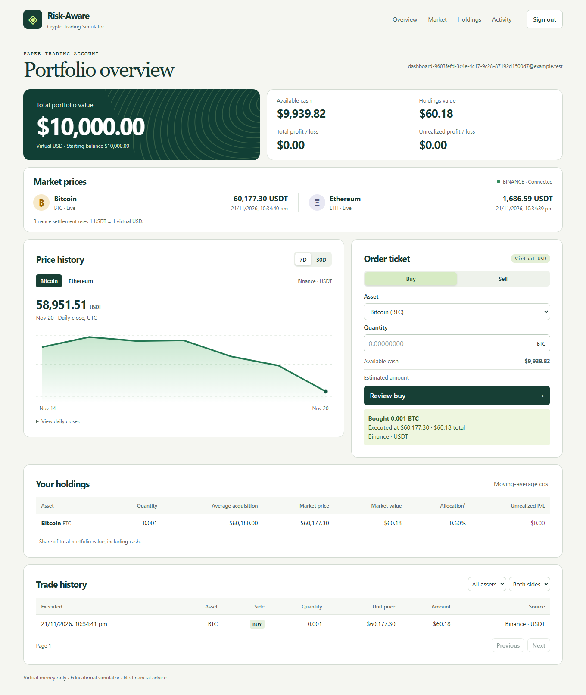
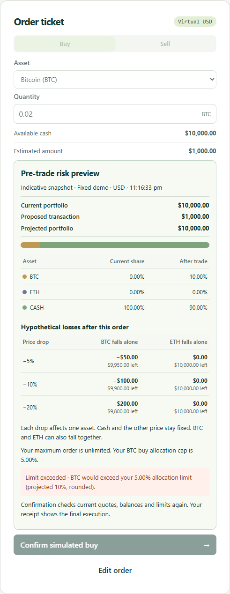
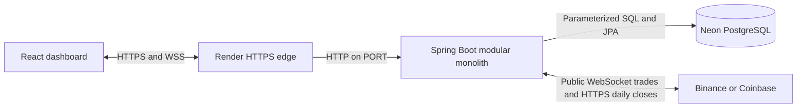
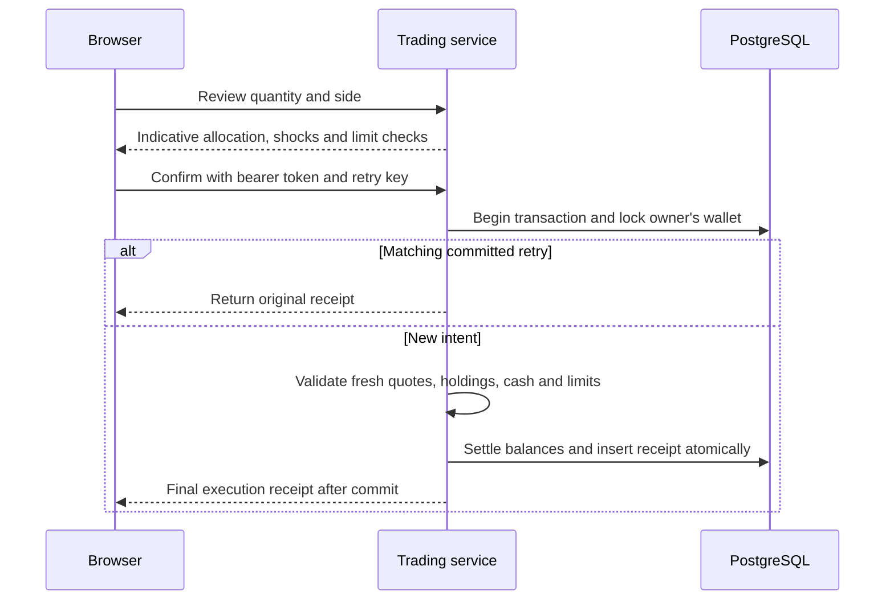

# Risk-Aware Crypto Trading Simulator

Practice buying and selling BTC and ETH with $10,000 in virtual USD. Review an order to see how it changes concentration and how much the projected portfolio would lose under six single-asset price shocks. Confirmation checks the latest prices, balances and personal limits again. All trades use virtual money. Historical risk statistics do not predict future outcomes. This simulator is for education only.

**For a five-minute demo**, register, sign in, set a 5% BTC allocation cap and review a purchase that exceeds it. Then reduce the quantity, confirm once and inspect the receipt and portfolio. Use `MARKET_MODE=MOCK_FIXED` for repeatable amounts or the default `LIVE` mode for observed daily volatility and drawdown. The dashboard labels the source in either mode.





### Architecture



The backend holds two current quotes in memory. Its public WebSocket carries market data only. Authenticated HTTP endpoints serve private portfolios and orders. The account, market, risk and trading modules share a database and a transaction manager. On Render, Spring serves the compiled React files from the same JAR. Local development uses Vite and its API and WebSocket proxy.



For a free cloud demonstration, use one **Render Free Web Service** and one **Neon Free PostgreSQL** project in Frankfurt. The root Dockerfile builds both halves. Follow the [manual setup, environment variables, budget controls and verification steps](docs/deployment.md) before creating either service.

### Final verification · 22 November 2026

| Check | Observed result |
| --- | --- |
| Java 21 and PostgreSQL 17.5 | Maven packaged the application. All 27 tests passed, including 7 account and 11 trading integration tests plus 9 market-data and risk tests. No tests skipped. |
| Frontend | TypeScript and Vite production build passed. Microsoft Edge completed both browser suites with the production Spring profile. The npm registry audit reported zero known advisories for the frontend lockfile on this date. |
| Offline browser demo | Registered and signed in through the forms. Checked the blocked allocation preview, buys and sells, lost-response retry, cent rounding, portfolio P/L, stale-price handling, mobile width and session expiry. |
| Live browser demo | Read observed BTC 7-close and ETH 30-close windows, reviewed a BTC purchase and received a simulated execution receipt sourced from Binance USDT. Connectivity was verified from the local machine. |
| Production proxy rehearsal | A loopback Nginx instance with a temporary certificate passed configuration validation, redirected HTTP to HTTPS, served the built UI, returned 401 for a private endpoint, delivered a price snapshot over WSS and returned 429 when the authentication request limit was reached. |

The hosting proposal has been checked against provider documentation. Public DNS, certificate issuance and renewal, exchange access from a cloud IP, and database backup restoration still require verification on an approved host.

**Render preparation rehearsal before the framework upgrade.** The bundled JAR served React, private APIs and the price WebSocket through one local HTTPS origin with the `prod,render` profiles and the image's 220 MB heap setting. All 27 backend tests passed against PostgreSQL 17.5. Both Edge suites passed, including socket reconnection, observed Binance history and a live-priced virtual purchase. A separate restart check recovered the same account, cash, position and idempotent receipt. Docker was unavailable on the test machine. Image construction, the actual 512 MB container ceiling, Neon TLS and exchange access from Render Frankfurt still require validation. See the [manual deployment guide](docs/deployment.md).

**Spring Boot 4.1.3 upgrade verification.** All 27 tests passed on PostgreSQL 17.5 and again on H2 with Java 21. The offline Edge suite passed against the bundled Render-profile JAR. A separate upgrade rehearsal preserved a BCrypt login, an unexpired JWT, a saved receipt and balances from 3.5.16. The live browser loaded observed BTC and ETH historical risk, but its buy preview stayed disabled on both runs. All 227 sampled Binance and Coinbase frames were future-dated relative to the test host. Repeat the LIVE browser check on a synchronized host before launch. Docker image construction and Frankfurt connectivity remain deployment checks.

### Reading the numbers

At the fixed $50,000 quote, buying 0.02 BTC moves $1,000 from cash into BTC. The portfolio still totals $10,000. A hypothetical 20% BTC drop reduces the position by $200 and the portfolio by 2%, assuming cash and ETH stay unchanged.

| Measure | What to explain during a demo |
| --- | --- |
| Profit and loss | Total P/L is marked portfolio value minus the $10,000 starting balance. Unrealized P/L compares remaining holdings with their moving-average cost. Selling a holding can realize a gain while its unrealized P/L goes to zero. |
| Execution | Java settles with decimal arithmetic. Buys round up and sells round down to cents. A round trip at the same price can cost a cent. The simulator assumes immediate full fills, zero fees and zero slippage. Browser marks are indicative. |
| Historical risk | Seven consecutive daily closes yield six daily returns. Sample volatility measures their spread. Drawdown follows their order, measuring the worst decline from an earlier closing peak. Both omit intraday moves. Thirty closes yield 29 returns. |
| Quote currency | Coinbase quotes USD. For Binance the simulator treats 1 USDT as 1 virtual USD. A stablecoin depeg or a price difference between providers can change the apparent portfolio value. |
| Scenarios | Each scenario shocks a single position. BTC and ETH can fall together, so the individual shocks do not measure the worst possible portfolio loss. |

## Run locally on Windows

Use PowerShell with a Java 21 JDK on PATH and Docker Desktop running with Linux containers and Compose v2. The Maven wrapper downloads Maven on first use. Alternatively, use an existing PostgreSQL installation as described below.

```powershell
Set-Location "$HOME\Desktop\crypto"
java -version
docker compose version
. .\scripts\local-env.ps1
docker compose up -d --wait db
Set-Location backend
.\mvnw.cmd clean verify
.\mvnw.cmd spring-boot:run
```

Open [Swagger UI](http://localhost:8080/swagger-ui/index.html). Register, log in, copy the returned access token, choose **Authorize**, paste the token, then execute **GET /api/me**. The machine-readable contract is at [OpenAPI](http://localhost:8080/v3/api-docs). The API and Compose database bind to loopback by default. Stop the API with Ctrl+C. Run `docker compose stop db` from the project root to stop PostgreSQL and keep the data.

The initialization script creates a git-ignored `.env` with two independent random secrets and loads them into the current shell. Dot-source it again in new shells. Keep this file private and retain it when restarting with the same database volume. Rotating the signing key invalidates existing tokens. Changing a database password in the file also requires updating the corresponding database role.

### Start the React client

With the API running on port 8080, open a second PowerShell window with Node.js 22.12 or newer installed.

```powershell
Set-Location "$HOME\Desktop\crypto\frontend"
npm.cmd ci
npm.cmd run build
npm.cmd run dev
```

Open [the simulator](http://127.0.0.1:5173). Create an account, sign in and check the opening balance. Vite forwards same-origin `/api` requests to Spring Boot during development. React holds the profile in memory, uses the login token to fetch it once and clears the profile on sign-out or expiry. Refreshing the browser opens the account access screen again. The production bundle in `frontend/dist` needs a host that routes `/api` to the backend. The frontend uses TypeScript for the account response shapes and Tailwind CSS for layout utilities.

### Try the account flow in another PowerShell window

```powershell
$api = 'http://localhost:8080/api'
$body = @{ email = "student-$([guid]::NewGuid())@example.test"; password = 'local-practice-passphrase' } | ConvertTo-Json
$account = Invoke-RestMethod -Method Post -Uri "$api/auth/register" -ContentType 'application/json' -Body $body
$account
$session = Invoke-RestMethod -Method Post -Uri "$api/auth/login" -ContentType 'application/json' -Body $body
Invoke-RestMethod -Uri "$api/me" -Headers @{ Authorization = "Bearer $($session.accessToken)" }
```

Both account responses should show the same UUID and a virtual cash balance numerically equal to 10000. Posting the same registration again should return HTTP 409. Calling `/api/me` without a token should return HTTP 401.

### Use PostgreSQL without Docker

Create a dedicated database and login role with a password using your local PostgreSQL administrator. Give the login role ownership of the database and permission to create tables in the default schema. From the root, load the local secrets and override the connection in the current shell before starting Spring Boot.

```powershell
. .\scripts\local-env.ps1
$env:DB_URL = 'jdbc:postgresql://localhost:5432/simulator'
$env:DB_USER = 'simulator'
$env:DB_PASSWORD = [System.Net.NetworkCredential]::new('', (Read-Host 'PostgreSQL role password' -AsSecureString)).Password
Set-Location backend
.\mvnw.cmd spring-boot:run
```

## Follow one request through the code

Sources live under `backend/src/main/java/dev/riskaware/simulator/`.

| Location | Responsibility |
| --- | --- |
| `account/AccountController.java`, `AccountApi.java` | Map JSON to validated request records and return small response records. Password hashes stay inside the persistence layer and service. |
| `account/AccountService.java` | Register an account and wallet atomically, check passwords, and load the signed-in user's profile. |
| `account/AppUser.java`, `Wallet.java` | Map the account and its one-to-one virtual wallet to relational tables. |
| `account/UserRepository.java`, `WalletRepository.java` | Spring Data JPA supplies standard database operations and an email lookup. |
| `security/SecurityConfig.java`, `TokenService.java` | Configure BCrypt and Spring Security's bearer-token filter, sign short-lived JWTs, and verify their signatures, issuer and time claims. |
| `account/ApiErrors.java` | Format validation and service errors as HTTP problem details without echoing submitted passwords. |
| `backend/src/main/resources/db/migration/` | Flyway applies versioned schema changes at startup. Hibernate validates the mappings. |
| `backend/src/test/java/` | Exercise HTTP requests, security filters, services, migrations, and repositories together. |

Registration normalizes the email, hashes the password with BCrypt cost 12, flushes the user insert, and saves the opening wallet. The unique constraint arbitrates simultaneous registrations. The service transaction commits both writes together. Login compares the submitted password against the stored salted hash. For an unknown email it performs a dummy hash comparison and returns the same invalid-credentials response.

After login the client sends the signed JWT in the Authorization header. Spring Security verifies it before the controller receives the request. The subject is the account UUID. The profile service looks up both rows by that UUID. Client input cannot select another wallet.

### Phase 1 schema

| Table | Columns and invariants |
| --- | --- |
| `app_users` | UUID primary key, normalized unique email (254 characters), BCrypt hash, UTC creation instant. |
| `wallets` | User ID is both primary key and foreign key. Cash uses NUMERIC(19,2) with a nonnegative check. Registration sets 10000.00 once. |

Java uses `BigDecimal` to represent virtual dollars exactly. Registration awards the opening balance once. Later calls to `/api/me` read the current settled cash balance.

### HTTP contract

| Method and route | Input | Success | Expected failures |
| --- | --- | --- | --- |
| POST `/api/auth/register` | Email and password | 201 with id, email, virtualCashUsd | 400 invalid input, 409 duplicate email |
| POST `/api/auth/login` | Email and password | 200 with accessToken, tokenType and expiresInSeconds | 400 invalid input, 401 invalid credentials |
| GET `/api/me` | Authorization bearer header | 200 with own id, email and virtualCashUsd | 401 missing, invalid or expired token |

Passwords must contain at least 12 characters and fit BCrypt's 72-byte UTF-8 input limit. Emails are trimmed and lowercased consistently. Tokens are signed with HS256 and issued for 15 minutes. Spring Security allows a small clock skew during validation. Tokens contain the user ID, issuer and timestamps. Treat them as credentials.

## Verification

From `backend`, run `.\mvnw.cmd clean verify`. The default suite starts Spring Boot with MockMvc and an isolated H2 database in PostgreSQL compatibility mode. It runs the Flyway migration and exercises registration, password hashing, normalized duplicates, validation, login, owner isolation, missing/tampered/expired tokens, API documentation, and rollback. Mockito injects a wallet-save failure after the user insert so the test can prove that the transaction discarded the user.

For PostgreSQL-specific verification with the running Compose service, use a **dedicated test database**. The tests create accounts and leave rows there. Run the database creation command once, then repeat the Maven command as needed.

```powershell
Set-Location "$HOME\Desktop\crypto"
. .\scripts\local-env.ps1
docker compose exec -T db createdb -U simulator simulator_test
$env:TEST_DB_URL = 'jdbc:postgresql://localhost:5432/simulator_test'
$env:TEST_DB_USER = 'simulator'
$env:TEST_DB_PASSWORD = $env:DB_PASSWORD
Set-Location backend
.\mvnw.cmd clean verify
```

## Interview notes

| Question | Concise answer |
| --- | --- |
| Why a modular monolith? | One deployment and one database keep local development manageable. Feature packages still give account, market data, and trading distinct responsibilities. |
| Why PostgreSQL and Flyway? | Foreign keys, uniqueness, decimal types and transactions enforce invariants across requests. Flyway makes the schema reproducible across machines. |
| Why put the transaction on the service? | Registration spans two repository calls. The service describes the whole operation, so both writes share one commit or rollback. |
| Why hash passwords if login uses JWT? | BCrypt protects the stored password verifier. The JWT authenticates subsequent requests after the user proves knowledge of the password. |
| Why use Spring Security's JWT support? | It centralizes bearer parsing and signature and timestamp checks. Controllers receive an authenticated principal. |
| Why a database constraint for duplicate email? | Two requests can pass an application-level lookup concurrently. The unique index allows only one row to commit. |
| How would you revoke a stolen token? | This phase relies on short expiry. Immediate per-user revocation would require additional server-side state. |
| What changes when this runs publicly? | Render handles TLS. Spring throttles login and registration. The production Spring profile disables API documentation. Operators supply secrets, restrict database access and verify dependency support, backups and provider connectivity. |

## Phase 2 — trading with mock prices

All four routes require the same bearer token used for `GET /api/me`. Use Swagger's **Authorize** button or the PowerShell session from the account example.

| Route | Behavior |
| --- | --- |
| GET `/api/prices/mock` | Return fixed BTC ($50,000) and ETH ($2,500) unit prices in virtual USD. |
| POST `/api/trades` | Send asset, side, quantity and a UUID in the `Idempotency-Key` header. Both initial success and replay return HTTP 200 with the original execution. |
| GET `/api/holdings` | Return the caller's positive balances in asset units. A full sale removes the empty position. |
| GET `/api/trades` | Return newest executions first. Filter by `asset`, `side`, inclusive `from` and exclusive `to` (ISO timestamps with offset, e.g. UTC Z). Page numbers start at 0. Default size is 20, maximum 100. `hasNext` indicates another page. |

### Try a buy, a retry, and a sale

For this fixed-price example, set `$env:MARKET_MODE = 'MOCK_FIXED'` in the backend PowerShell window before starting the API. After obtaining `$session` and `$api` in the account example, use these commands.

```powershell
$auth = @{ Authorization = "Bearer $($session.accessToken)" }
Invoke-RestMethod "$api/prices/mock" -Headers $auth
$orderHeaders = $auth.Clone()
$orderHeaders['Idempotency-Key'] = [guid]::NewGuid().ToString()
$buy = @{ asset = 'BTC'; side = 'BUY'; quantity = '0.02' } | ConvertTo-Json
Invoke-RestMethod "$api/trades" -Method Post -Headers $orderHeaders -ContentType 'application/json' -Body $buy
Invoke-RestMethod "$api/trades" -Method Post -Headers $orderHeaders -ContentType 'application/json' -Body $buy
Invoke-RestMethod "$api/holdings" -Headers $auth
$orderHeaders['Idempotency-Key'] = [guid]::NewGuid().ToString()
$sell = @{ asset = 'BTC'; side = 'SELL'; quantity = '0.005' } | ConvertTo-Json
Invoke-RestMethod "$api/trades" -Method Post -Headers $orderHeaders -ContentType 'application/json' -Body $sell
Invoke-RestMethod "$api/me" -Headers $auth
(Invoke-RestMethod "$api/trades?asset=BTC&page=0&size=10" -Headers $auth).trades
```

Starting with an unused account, the two buy responses share a trade ID. After the sale, the wallet holds **$9,250.00** and **0.015 BTC**. The history has two executions. A client should generate its key before submission, retain it through uncertain outcomes, and generate a new key for each new order.

### Follow a trade through the code

1. `trading/TradeController.java` takes the account ID from the authenticated JWT and validates the order. Quantity must be positive with up to eight fractional digits and twelve integer digits.
2. `trading/TradeService.java` starts one database transaction. `TradeRepository.lockCash` locks the caller's existing wallet row with `SELECT ... FOR UPDATE`. Two simultaneous buys can both target a new holding, so the lock belongs on the wallet, which already exists.
3. After obtaining the lock, the service looks up the account and request key. A matching asset, side and numerical quantity replay the persisted receipt. A different order using a successful key gets HTTP 409. Failed validations and rolled-back attempts leave the key available.
4. `MockPrices.java` supplies the execution price. Multiplication uses `BigDecimal`. The minimum gross order value is one cent. Buys round fractional cents up and sells round them down so splitting or reversing an order cannot manufacture cash. Fees are zero. For example, a $25.0025 purchase debits $25.01 and a sale of the same amount credits $25.00.
5. The service checks the resulting cash and units. Insufficient cash or holdings returns HTTP 409. It then updates the wallet and position and appends the execution. Spring commits all three writes together. The database releases the wallet lock when the transaction ends.

`V2__holdings_and_trades.sql` adds one holding per account and asset, positive-amount constraints, a unique execution key per account, and a history index. The application exposes trade records as immutable Java records with an insert-only repository path. The execution stores its actual price, source, cash amount and UTC timestamp. The trading repository uses Spring's parameterized JDBC client to make locking and writes explicit. It shares the application's existing PostgreSQL datasource and Spring transaction manager with the JPA account module.

### Tests and interview notes

Run the verification commands above for H2 or PostgreSQL. `TradeIntegrationTest` sends authenticated HTTP requests against the real service and repositories. It checks retries, conflicting keys, account isolation, overspending, overselling, settlement, pagination and date filters. Two worker threads race orders on one wallet. A separate test injects a failure after the history insert, checks all three tables, and retries with the same key.

| Interview question | Short answer |
| --- | --- |
| Why are a transaction and a lock both necessary? | A transaction commits the writes together. The wallet lock also serializes the read-check-write sequence so a second order sees the first one's committed balance. |
| What happens if the client times out after commit? | A retry with the same key reads the original execution from PostgreSQL. That also works after an application restart. |
| What limits throughput? | Orders on one wallet execute sequentially. Separate wallets lock separate rows. This trade-off keeps account-level accounting simple. |
| What are the limits of this simulation? | Orders fill completely with zero fees. Mock mode uses fixed prices. History uses offset pagination, so new executions can shift later pages between reads. |

## Phase 3 — live market data

In the prepared Windows workspace, stop an older backend in its terminal with Ctrl+C, then run the following in PowerShell. For a fresh checkout, use the Maven and database instructions at the top.

```powershell
Set-Location "$HOME\Desktop\crypto"
$env:MARKET_MODE = 'LIVE'
$env:MARKET_PROVIDER = 'AUTO'
& .\.local-tools\start-api.ps1
```

In a second window run `Set-Location "$HOME\Desktop\crypto\frontend"` and `npm.cmd run dev`. Sign in at [the simulator](http://127.0.0.1:5173) to use the trading dashboard. Swagger also supports the trading API.

| Environment variable | Values and behavior |
| --- | --- |
| `MARKET_MODE` | `LIVE` (default) or `MOCK_FIXED`. Mock mode keeps the fixed BTC/ETH prices and provides a clearly labeled flat daily series, entirely offline. Restart the API to change mode. |
| `MARKET_PROVIDER` | `AUTO` (default) starts with Binance and alternates with Coinbase after failures, including a silent subscription. Pin `BINANCE` or `COINBASE` to reconnect only to that exchange. Pin Coinbase if the Binance history service is inaccessible. |
| `MARKET_MAX_AGE_SECONDS` | 1–120, default 20. A live order requires a connected feed and a quote inside this exchange-time window. Keep the server clock synchronized. |

### APIs and execution

| Route | Result |
| --- | --- |
| `GET /api/market/prices` | Authenticated snapshot of mode, provider and both assets. Each row has a status and a nullable quote. |
| `WS /ws/prices` | Public, read-only market snapshots. A browser receives an initial snapshot, coalesced changes at most once a second, and a heartbeat snapshot approximately every ten seconds during quiet periods. Serve this path with WebSocket upgrade support alongside the HTTP API. Vite proxies both locally. |
| `GET /api/market/history/BTC?days=30` | Authenticated daily closes, ascending by UTC date. Use BTC or ETH and 1–90 completed calendar days. The response includes asset, source, interval and prices. |
| `POST /api/trades` | Same account, order and idempotency contract as Phase 2. New orders receive HTTP 503 while their asset is unavailable, stale, or disconnected. A successful retry returns the persisted execution even then. |

The legacy `/api/prices/mock` route always lists demonstration values. Use `/api/market/prices` for the active trading mode. Binance quotes BTC/USDT and ETH/USDT. For virtual accounting the simulator values **one USDT at one virtual USD**. Coinbase quotes BTC/USD and ETH/USD directly. Source labels on receipts distinguish these conventions. A real USDT/USD deviation can affect comparisons across providers.

### Follow a price from exchange to receipt

1. `market/ExchangeFeed.java` opens one outbound public WebSocket using Java 21's HTTP client. `ExchangeData.java` extracts the last trade price and exchange trade timestamp for the two supported pairs. On disconnect the feed invalidates execution immediately. It reconnects with exponential backoff up to 60 seconds. AUTO can switch to the other live provider.
2. `MarketBook.java` keeps the latest validated price per asset in memory. It rejects invalid decimals, future timestamps and older updates. Each connection has its own generation number, so a late callback from a previous connection cannot overwrite a current price. Restarting clears live quotes until fresh data arrives.
3. `PriceSocket.java` sends public snapshots to connected browsers. `frontend/src/MarketPrices.tsx` closes a silent socket and reconnects with backoff. This coalescing protects the display from exchange tick volume. The service still reads the latest accepted tick when executing.
4. `TradeService.java` locks the wallet, looks for an existing receipt, then asks the book for an executable quote. The exchange connection and historical HTTP requests are independent of this transaction. PostgreSQL stores the exact accepted unit price (up to 12 decimal places), its source, its market timestamp at microsecond precision, and the simulator's execution time. Cash settlement still rounds to cents. Migration V3 keeps older receipts readable with a null market timestamp.
5. `DailyHistory.java` fetches daily closes on demand from one provider per response. Completed UTC days prevent a partial current-day candle from skewing later risk calculations. Full results are cached per asset/provider until UTC midnight. Short results are cached for one minute and a requested window with a gap returns 503. Provider failures start a cooldown, including at least 60 seconds for HTTP 429/418 and longer numeric Retry-After instructions. Daily history is independent of the executable quote.

**Try the API** after logging in with the PowerShell account example.

```powershell
$auth = @{ Authorization = "Bearer $($session.accessToken)" }
Invoke-RestMethod "$api/market/prices" -Headers $auth | ConvertTo-Json -Depth 5
(Invoke-RestMethod "$api/market/history/ETH?days=7" -Headers $auth).prices
```

### Verification and interview notes

Live smoke checks on 21 November 2026 exercised Binance and Coinbase separately. For each provider, the packaged API received fresh BTC and ETH ticks, the signed-in browser rendered the WebSocket price cards, both history requests returned three completed daily closes, and one virtual BTC purchase recorded the provider and exchange timestamp. Availability depends on the network and provider.

Run `.\mvnw.cmd verify` from `backend`, then use the earlier PostgreSQL test commands for a database-backed run. Run `npm.cmd run build` from `frontend`. Tests explicitly select mock mode. Market tests use sample exchange frames, mocked HTTP responses and a fixed clock. They exercise precision, stale and reordered prices, loss of connection, failover, candle ordering and rate limits. The trading suite also checks that an outage blocks a new trade while a prior receipt still replays with its exact price and quote time.

| Interview question | Answer |
| --- | --- |
| Why keep the latest quote in memory? | This single-process application needs two current prices. Reading memory during a wallet transaction avoids waiting for an external network request while holding a database lock. Executed quotes persist in PostgreSQL. |
| Why use the exchange timestamp? | A delayed packet can arrive now with an old trade price. Measuring age against exchange time catches that case. |
| What does LIVE mean here? | The price is an observed trade on the selected exchange. A paper order assumes a complete fill at that price. It does not model an order book, slippage, fees, stablecoin exchange rates or market impact. |
| What happens on provider change? | The book clears the previous session's quotes. The alternate provider must publish a valid price for an asset before trading resumes. History uses a single source per window. |

Provider contracts: [Binance spot streams](https://developers.binance.com/docs/binance-spot-api-docs/web-socket-streams), [Binance daily klines](https://developers.binance.com/docs/binance-spot-api-docs/rest-api/market-data-endpoints), [Coinbase ticker](https://docs.cdp.coinbase.com/exchange/websocket-feed/channels), [Coinbase daily candles](https://docs.cdp.coinbase.com/api-reference/exchange-api/rest-api/products/get-product-candles).

## Phase 4 — trading and portfolio dashboard


Sign in to see the portfolio, BTC/ETH feed, daily chart, order ticket, positions and execution history. The ticket supports fractional units, reviews an estimate and confirms with the price on the backend receipt. The chart offers 7 or 30 completed UTC days, a pointer readout and an accessible table of closes. A flat MOCK_FIXED chart uses the offline service's labeled fixed-price series. Missing days or a failed provider produce an error with a retry action.

### Start and try a trade

Use the Windows setup at the top for a new checkout. In the prepared workspace, stop any previous API instance in its terminal and run the packaged API in PowerShell.

```powershell
Set-Location "$HOME\Desktop\crypto"
$env:MARKET_MODE = 'MOCK_FIXED'
& .\.local-tools\start-api.ps1
```

Open a second window for React.

```powershell
Set-Location "$HOME\Desktop\crypto\frontend"
npm.cmd ci
npm.cmd run dev
```

Open [the local dashboard](http://127.0.0.1:5173). On a fresh mock account, buy 0.02 BTC and sell 0.005 BTC. Expect $9,250 cash, 0.015 BTC worth $750, and $10,000 total value. Filter history by BTC and SELL to inspect the $250 receipt. To use actual prices, restart the API with `$env:MARKET_MODE = 'LIVE'`. The provider, timestamp and feed state appear beside the quotes. Binance's USDT pairs use the documented one-to-one virtual USD approximation.

### Accounting and data flow

| Measure | Definition |
| --- | --- |
| Cash | Settled virtual wallet balance. |
| Holdings value | Sum of quantity × latest valid price for each open position. |
| Total portfolio value | Cash plus holdings value. |
| Total profit/loss | Total portfolio value less the original $10,000 grant. Includes gains or losses already realized through sales. |
| Unrealized profit/loss | Current value of open positions less their remaining acquisition costs. |
| Asset allocation | An asset's current value divided by total portfolio value, including cash. |

`GET /api/portfolio` reads the JWT subject, wallet and ordered receipts in one read-only repeatable-read transaction. `PortfolioService` reconstructs moving-average acquisition cost with Java BigDecimal and DECIMAL128 division. Buys add their actual settled cash amount, including cent rounding. A partial sale removes the same fraction of acquisition cost as the units sold. Selling the last unit clears the basis. A later purchase starts a new position. For example, buying one ETH at $2,500 and another at $3,500 gives a $3,000 average. Selling 0.5 ETH at $3,500 leaves 1.5 ETH costing $4,500. At the sale price, unrealized gain is $750 and total gain is $1,000.

The portfolio endpoint needs no schema migration and reads old receipts. Its work grows with the user's trade count. For this local simulator that keeps the calculation auditable. A larger deployment could maintain cost basis in the trade transaction. The browser uses JavaScript numbers to display indicative valuations and calculates them again on each WebSocket update. All settlement and persisted amounts use backend decimals. If any held asset lacks a current usable quote, aggregate valuation shows a dash. Cash stays available.

### Reliability and interview notes

- **How does the dashboard recover from a lost trade response?** On confirmation it saves the request body and its UUID for the signed-in account. A retry submits the same intent, including after reload and sign-in in the same tab. PostgreSQL returns the original receipt after a successful commit. The ticket disables further submission while a request is pending. Session storage contains the intent only. JWTs stay in React memory. If browser storage is disabled, pending intent recovery is limited to the mounted page.
- **Why can the price move after review?** The estimate uses the last displayed quote. The server independently selects a fresh quote after acquiring the wallet lock. The success message uses the executed unit price and settled cash amount from that receipt.
- **How do updates stay consistent?** A confirmed execution triggers a new portfolio snapshot and refreshes the active history filters. React cancels superseded reads. Market ticks update display values locally without fetching another account ledger. Trades in another tab become visible on reloading and signing in.
- **What does an expired session do?** The local expiry timer and authenticated HTTP 401 responses each return the user to sign-in. Each portfolio query uses the token subject for ownership.

### Repeatable checks and screenshot guidance

Run the Maven verification and PostgreSQL test commands in the earlier verification section. The integration suite covers weighted acquisition costs, partial sales, full liquidation, repurchase, and owner isolation in addition to the earlier concurrency and idempotency checks. Run `npm.cmd run build` from `frontend` for TypeScript and Vite verification.

With Microsoft Edge installed and the API and frontend running locally, execute the browser checks from another PowerShell window. Each run creates a disposable account in the selected database.

```powershell
Set-Location "$HOME\Desktop\crypto\frontend"
$env:DASHBOARD_URL = 'http://127.0.0.1:5173'
$env:DASHBOARD_TEST_MODE = 'MOCK_FIXED'
npm.cmd run test:dashboard
```

The mock check exercises both assets and sides, a committed order whose response is dropped, retry and double-click behavior, price-driven value changes, stale prices, insufficient funds and holdings, filters, chart periods, a mobile viewport and session expiry. Injected price changes and a simulated HTTP 401 are confined to the test browser. Set both the backend and test mode to LIVE for the real-provider check, which places a virtual BTC order, reads the live receipt and displays the position.

For a README or interview screenshot, use a disposable account and keep the market-mode indicator visible. Capture the overview after a buy and partial sale, then capture a filtered history row with its matching receipt. To save a full-page image during the mock test, set `$env:DASHBOARD_SCREENSHOT` to a writable absolute PNG path before running it.

## Phase 5 — historical risk and pre-trade preview

Sign in and open **Risk** in the dashboard navigation. Historical observations describe a named exchange and past UTC dates. Current concentration uses your settled wallet and holdings. The order ticket has its own indicative assessment, taken when you select **Review**. Confirming sends the original order to the existing execution endpoint.

### Interpreting the numbers

| Measure | Calculation and interpretation |
| --- | --- |
| Daily return | For consecutive completed closes, divide today's close by yesterday's close and subtract one. A move from 100 to 110 gives +10%. |
| Daily historical volatility | For 7 or 30 closing dates there are 6 or 29 returns. Compute their arithmetic mean, square each return's difference from that mean, sum, divide by the number of returns minus one, then take the square root. Multiply by 100 for a daily percentage. This is sample standard deviation. The display does not annualize it. Large positive and negative moves both contribute. |
| Maximum drawdown | Walk forward through the closes, keeping the highest close seen so far. At each date compute 100 × (peak − close) / peak. Report the largest decline as a positive magnitude and show its peak and trough dates. An increasing series has zero drawdown and no loss interval. Ties keep the first qualifying interval. |
| Allocation | Mark each held quantity at its current validated unit price. Total value is BTC value + ETH value + cash. Divide each component by this total. A crypto position above 50% is flagged because that single asset represents a majority of virtual wealth. This descriptive threshold is separate from the user's hard limits. BTC and ETH can move together. |
| One-asset shock | For a selected drop of 5%, 10% or 20%, loss = marked value of the affected holding × drop fraction. Scenario total = original total − loss. Each column changes one price independently while quantities, cash and the other price are fixed. These scenarios have no probability attached. |

A known volatility example uses seven closes of 100, 110, 99, 99, 99, 99 and 99. The six daily returns are +10%, −10% and four zeros. Their mean is zero. The sample daily volatility is about 6.32% and maximum drawdown is 10%, from 110 to 99. Neither statistic bounds future losses. The window excludes earlier peaks and daily closes can miss intraday losses.

### Architecture and execution rules

- **History.** Authenticated `GET /api/market/risk/{BTC|ETH}?days=7` accepts 7 or 30. `HistoricalRisk` consumes the existing daily-history cache and requires the whole consecutive window of positive exchange closes. It returns source, dates, counts, daily volatility and drawdown dates. An incomplete window or provider failure produces an unavailable state. MOCK_FIXED keeps the educational order preview and scenarios available, and suppresses observed historical metrics. No historical series is generated for risk analysis.
- **Limits.** `GET /api/risk/limits` and `PUT /api/risk/limits` read and save the JWT owner's settings. Migration V4 adds three fields to the existing wallet. The defaults preserve previous trading behavior: maximum virtual order value disabled, BTC and ETH caps each 100%. An empty order cap clears it. Allocation caps allow 0–100%, including both endpoints.
- **Preview.** `POST /api/trades/preview` takes the same asset, side and quantity as an order. A read-only repeatable-read transaction reads one consistent account state. `OrderAssessment` captures a fresh price for the traded asset and each held asset from the same in-memory feed generation. It applies the established buy-up/sell-down cent settlement, then computes current and projected exposures. The response includes quote time, source, assessed amount, limits and violations. The preview neither reserves cash nor creates a trade.
- **Confirmation.** After acquiring the wallet lock, execution checks for an existing idempotent receipt first. For a new order it reads current holdings, current settings and validated quotes, then runs the same assessment. Limit changes take that wallet lock too. Only a passing order reaches the wallet, holdings and immutable trade writes. Browser percentages are rounded for display. The backend compares exact BigDecimal amounts by cross-multiplication.
- **Which trades are blocked?** The order-value limit checks the actual settled amount on both buys and sells. A buy cannot take the purchased asset above its cap. A sale can reduce an already overweight position, subject to the order-value limit. Price drift alone never liquidates a holding. Exactly meeting a limit is allowed. A warning about majority exposure is informational. A hard breach gives HTTP 422 with the values and the limit. Invalid orders, insufficient balances and unavailable quotes retain their existing validation errors.
- **Limitations.** The display uses the browser's numeric precision for indicative allocations and scenario amounts. Execution checks use backend decimals. Preview values can change before confirmation. A stale price on a different held asset can also prevent execution because the allocation denominator requires a complete valuation. Fees remain zero, and Binance USDT is valued at one virtual USD. The shocks omit correlated moves, slippage and liquidity. They are illustrations rather than forecasts.

### Manual verification

The [verified order-ticket screenshot](docs/risk-preview.png) shows the 5% BTC cap blocking a proposed 10% allocation, along with all six post-trade scenarios.

Use the Phase 4 Windows startup commands. In the prepared workspace, the local launcher loads the 0.5.0 JAR. Start with MOCK_FIXED and a new $10,000 virtual account.

1. Open Risk → Trading limits. Set BTC's cap to 5% and save. Review a buy of 0.02 BTC at the fixed $50,000 quote. The proposed order is $1,000, taking BTC from 0% to 10%. Confirmation is disabled. The cash balance is still $10,000.
2. Inspect the 20% BTC shock in that preview. It shows a $200 hypothetical loss and $9,800 remaining. The same ETH shock loses $0 because this portfolio holds no ETH.
3. Set BTC's cap to 10%, review again, then confirm. The receipt and holdings reflect one purchase. Set the cap below the new allocation and review a partial sale. The sale can reduce the position. Try a maximum order of $50 and review a larger sale to exercise the independent order-value limit.
4. Restart in LIVE mode, sign in and choose each asset and window. Check the provider, UTC dates, 6 or 29 returns, and peak/trough interval. The hypothetical panel remains available independently of a historical API failure if current quotes are fresh.
5. To exercise execution-time enforcement manually, review an allowed buy, tighten the limit in another signed-in tab for the same account, and confirm in the first tab. The server rejects the trade using the updated limit.

Run the Maven, PostgreSQL and Edge test commands documented above. The risk tests include known daily returns, a multi-day decline with a partial recovery, missing dates, mock-history exclusion, cap equality, ownership and idempotent replay. They verify that rejected trades leave cash, holdings and history intact when a price or limit changes or another holding becomes stale. Two individually affordable concurrent buys can commit only within their shared allocation cap. The dashboard browser check exercises a blocked preview and an allowed confirmation. LIVE mode also checks observed historical windows.

### Interview questions

| Question | Answer |
| --- | --- |
| Why do seven closes yield six returns? | A return compares two consecutive prices. The first close supplies the starting point. |
| Why can two assets have similar volatility and different drawdowns? | Volatility measures dispersion of daily returns. Drawdown depends on their sequence and measures a cumulative decline from an earlier peak. |
| Why validate twice? | Review captures an indicative portfolio. Another order, a limit edit or a new quote can change the result. Checking again while the wallet is locked prevents simultaneous orders from both spending the same allocation headroom. |
| Why skip historical metrics offline? | A flat demo price encodes no observation about the real market. Reporting zero observed risk from that series would mislead the learner. |
